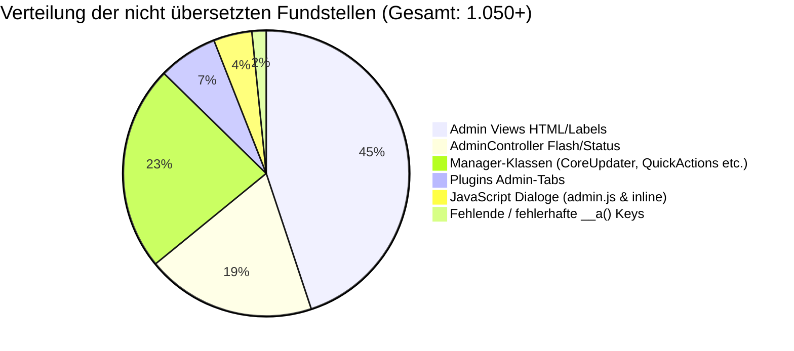
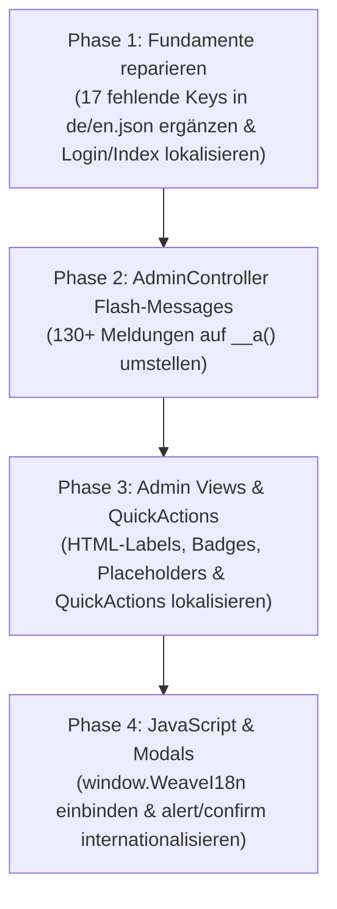

# WeaveCMS – Umfassender i18n-Audit des Administrations-Backends

> **Dokumentationsstatus:** Vollständige Bestandsaufnahme aller nicht übersetzten und hardcodierten deutschen Textbausteine im WeaveCMS Admin-Backend.  
> **Erstellt:** November 2026  
> **Ziel:** Vollständige Lokalisierbarkeit des gesamten Backends (DE / EN) gemäß Architekturstandard mit striktem Englisch-Fallback.

---

## 1. Executive Summary & Architektur-Befund

Das WeaveCMS Admin-Backend verfügt mit `LanguageManager::adminT()` bzw. dem Helper `__a($key, $default, $lang, $params)` und den Sprachkatalogen in `libs/lang/admin/de.json` und `en.json` (jeweils **1.259 Schlüssel**) über eine solide Grundlage. Beide JSON-Dateien sind synchron und übersetzt.

**Das Kernproblem:**  
Große Teile der Benutzeroberfläche und der Interaktionslogik greifen **nicht** auf das Übersetzungssystem zu. Stattdessen wurden deutsche Texte direkt im Quellcode verankert. Schaltet ein Administrator auf Englisch (`?admin_lang=en`), bleiben hunderte Texte, Dialoge und insbesondere Feedback-Meldungen auf Deutsch.



### Übersicht der Fundstellen nach Modulen:
| Bereich / Komponente | Fundstellen | Typischer Inhalt | Primäre Ursache |
| :--- | :---: | :--- | :--- |
| **Admin Views (`admin/views/`)** | **475** | Labels, Placeholders, Buttons, Th-Header, Badges | Direktes HTML ohne `__a()` |
| **AdminController (`libs/php/AdminController.php`)** | **203** | `$success_msg`, `$error_msg`, Flash-Notices | Hardcodierte deutsche Strings |
| **System-Manager (`libs/php/`)** | **246** | QuickActions, Updater, Backups, Rollen-Texte | Hardcodierte Kataloge & Meldungen |
| **Plugins Admin-Bereiche (`plugins/*`)** | **71** | Ticket-Status, Shop-Orders, Forum-Migration | Fehlende Plugin-i18n-Kataloge |
| **JavaScript (`libs/js/admin.js` & Views)** | **46** | `confirm()`, `alert()`, dynamische DOM-Inhalte | Feste Strings in JS-Dateien |
| **Fehlende Keys in `en.json` / `de.json`** | **17** | 2FA, Downloads-Mediathek, Tags-Felder | Keys im Template, aber nicht im JSON |

---

## 2. Fehlende und fehlerhafte Schlüssel (`__a()` ohne JSON-Eintrag)

In den Templates werden 17 Schlüssel über `__a()` aufgerufen, die **weder in `en.json` noch in `de.json`** existieren. Dadurch greift immer der deutsche Fallback-Parameter:

| Datei & Zeile | Aufgerufener Schlüssel | Aktueller deutscher Fallback | Benötigte englische Übersetzung |
| :--- | :--- | :--- | :--- |
| `admin/views/login.php:79` | `admin.login.2fa_placeholder` | `6-stelliger Code oder Backup-Code` | `6-digit code or backup code` |
| `admin/views/tab_downloads.php:198` | `admin.downloads.source_media` | `Aus Mediathek wählen` | `Select from media library` |
| `admin/views/tab_downloads.php:211` | `admin.downloads.btn_pick_from_media` | `Aus Mediathek wählen` | `Choose from library` |
| `admin/views/tab_downloads.php:220` | `admin.downloads.field_media_selected` | `Ausgewählte Datei aus Mediathek:` | `Selected file from media library:` |
| `admin/views/tab_downloads.php:234` | `admin.downloads.btn_change_media` | `Ändern` | `Change` |
| `admin/views/tab_downloads.php:237` | `admin.downloads.btn_remove_media` | `Entfernen` | `Remove` |
| `admin/views/tab_downloads.php:245` | `admin.downloads.btn_open_picker` | `Mediathek öffnen & Datei auswählen...` | `Open media library & select file...` |
| `admin/views/tab_downloads.php:414` | `admin.downloads.label_media_file` | `Mediathek` | `Media Library` |
| `admin/views/tab_downloads.php:441` | `admin.downloads.modal_media_title` | `Datei aus Mediathek auswählen` | `Select file from media library` |
| `admin/views/tab_downloads.php:444` | `admin.downloads.modal_media_subtitle` | `Wähle ein hochgeladenes Dokument...` | `Choose an uploaded document, archive or image.` |
| `admin/views/tab_pages.php:143` | `admin.pages.field_tags` | `Schlagwörter (Tags)` | `Tags` |
| `admin/views/tab_pages.php:144` | `admin.pages.tags_hint` | `Kommagetrennt, z. B. Natur, Handwerk...` | `Comma-separated, e.g. nature, craft...` |
| `admin/views/tab_pages.php:145` | `admin.pages.placeholder_tags` | `Handwerk, Natur, Deko` | `Craft, nature, decoration` |
| `admin/views/tab_pages.php:150` | `admin.pages.existing_tags` | `Bestehende Tags:` | `Existing tags:` |
| `admin/views/tab_pages.php:154` | `admin.pages.` *(Syntaxfehler!)* | *(leer)* | *Key reparieren oder entfernen* |
| `libs/php/CustomFieldManager.php:238` | `frontend.custom_fields.heading` | `Zusatzinformationen` | `Additional Information` |
| `libs/php/CustomFieldManager.php:258` | `frontend.custom_fields.yes` | `Ja` | `Yes` |

---

## 3. Detail-Befund: AdminController (`libs/php/AdminController.php`)

`AdminController.php` steuert sämtliche POST- und GET-Aktionen des Backends. Über **130 Erfolgs- und Fehlermeldungen** sind hartkodiert auf Deutsch hinterlegt. 

### Typische Fundstellen:
```php
// Zeile 574:
$success_msg = 'Darstellungseinstellungen erfolgreich gespeichert!';
// Zeile 576:
$error_msg = 'Fehler beim Speichern der Darstellungseinstellungen.';
// Zeile 603:
$error_msg = 'Fehler beim Hochladen des Logos (nur SVG, PNG, WebP, JPG erlaubt).';
// Zeile 868:
$success_msg = 'Status der Anfrage aktualisiert.';
// Zeile 946:
$success_msg = 'Sektions-Reihenfolge erfolgreich aktualisiert!';
// Zeile 1083:
$success_msg = 'Benutzer erfolgreich angelegt.';
// Zeile 1115:
$error_msg = 'Passwort muss mindestens 8 Zeichen lang sein.';
// Zeile 1412:
$success_msg = 'Sicherung erfolgreich wiederhergestellt!';
```

### Lösung:
Alle Zuweisungen müssen auf `__a()` umgestellt werden:
```php
// Vorher:
$success_msg = 'Darstellungseinstellungen erfolgreich gespeichert!';
// Nachher:
$success_msg = __a('admin.msg.display_saved', 'Darstellungseinstellungen erfolgreich gespeichert!');
```

---

## 4. Detail-Befund: Admin Views (`admin/views/*.php`)

In den Template-Dateien wurden zwar die Sektions-Überschriften meistens mit `__a()` ausgestattet, Formularfelder, Tabellen-Header, Platzhalter und Badges jedoch häufig direkt auf Deutsch belassen.

### 4.1 `admin/views/tab_settings.php` (119 Fundstellen)
* **Wartungsmodus:** `"Wartungsmodus aktivieren"`, `"Hinweis: Administratoren können die Website weiterhin normal aufrufen."`
* **Upload-Beschränkungen:** `"Maximale Dateigröße"`, `"Erlaubte Dateiendungen"`, `"Standard-Upload-Verzeichnis"`
* **Zeitzone & Datumsformat:** `"Standard-Zeitzone"`, `"Europäische Zeitzone (Berlin, Wien, Zürich)"`
* **Mailer-Setup:** `"Test-E-Mail senden"`, `"Empfänger-Adresse"`, `"Verbindung testen"`, `"Verschlüsselung: TLS / SSL"`
* **Speichertreiber:** `"Aktiver Speichertreiber"`, `"Flat-File JSON-Speicherung"`, `"SQLite-Datenbank"`, `"MySQL/MariaDB-Datenbank"`

### 4.2 `admin/views/tab_security.php` (100 Fundstellen)
* **CSP & Header:** `"Content Security Policy (CSP) Schutzstufe"`, `"Streng (Strict)"`, `"Standard (Empfohlen)"`, `"Deaktiviert"`
* **Brute-Force & Rate-Limiting:** `"Max. Fehlversuche vor Sperre"`, `"Sperrdauer in Minuten"`, `"IP-Whitelisting"`
* **2-Faktor-Authentifizierung (2FA):** `"TOTP Authenticator-App einrichten"`, `"QR-Code mit Authenticator scannen"`, `"Wiederherstellungscodes sichern"`
* **Sicherheits-Audit-Log:** `"Ereignis-Typ"`, `"IP-Adresse"`, `"Benutzer"`, `"Zeitstempel"`, `"Keine verdächtigen Ereignisse gefunden."`

### 4.3 `admin/views/tab_design.php` (62 Fundstellen)
* **Farbschema & Typografie:** `"Primärfarbe (Akzente, Buttons, Links)"`, `"Hintergrundfarbe"`, `"Textfarbe"`, `"Schriftart für Überschriften"`, `"Schriftart für Fließtext"`
* **Logo & Favicon:** `"Bild-Logo verwenden"`, `"SVG-Code verwenden"`, `"Favicon hochladen"`, `"Vorschau im Browser-Tab"`
* **Custom CSS:** `"Individuelles CSS"`, `"Wird am Ende des <head>-Bereichs eingebunden."`

### 4.4 `admin/views/tab_users.php` (58 Fundstellen)
* **Benutzer-Modal & Formulare:** `"Neues Passwort (optional)"`, `"Passwort wiederholen"`, `"Rolle zuweisen"`, `"Administrator"`, `"Moderator"`, `"Redakteur"`
* **Tabelle & Badges:** `"Letzter Login"`, `"Nie"`, `"Aktionen"`, `"Bearbeiten"`, `"Löschen"`, `"2FA Status: Aktiv / Deaktiviert"`

### 4.5 `admin/views/tab_downloads.php` (58 Fundstellen)
* **Dateiverwaltung:** `"Aus Mediathek wählen"`, `"Datei hochladen"`, `"Kategorie zuweisen"`, `"Download-Zähler zurücksetzen"`
* **Berechtigungen:** `"Öffentlich verfügbar"`, `"Nur angemeldete Benutzer"`, `"Zugriffsschutz"`

### 4.6 `admin/views/tab_media.php` (46 Fundstellen)
* **Dropzone:** `"Dateien hier ablegen oder durchsuchen..."`, `"Maximale Upload-Größe: {size}"`
* **Detail-Ansicht:** `"Dateiname"`, `"Dateigröße"`, `"Abmessungen"`, `"Alt-Text (Bildbeschreibung)"`, `"Inhalt speichern"`, `"Datei löschen"`

### 4.7 `admin/views/tab_courses.php` & `tab_past.php` (43 Fundstellen)
* **Felder:** `"Veranstaltungsort"`, `"Maximale Teilnehmerzahl"`, `"Freie Plätze"`, `"Teilnahmegebühr"`, `"Dozent / Kursleiter"`
* **Status:** `"Ausgebucht"`, `"Wenige Plätze frei"`, `"Abgeschlossen"`

### 4.8 `admin/views/tab_display.php` (38 Fundstellen)
* **Layout-Konfiguration:** `"Sektionen-Reihenfolge anpassen"`, `"Modul-Sichtbarkeit umschalten"`, `"Im Navigationsmenü anzeigen"`

### 4.9 `admin/views/partials/api_webhooks.php` (36 Fundstellen)
* **REST & Webhooks:** `"REST-API Endpunkte Übersicht"`, `"Header für Aufrufe: Authorization: Bearer"`, `"API-Token unwiderruflich löschen?"`, `"Webhook-Protokoll leeren"`

### 4.10 `admin/index.php` (37 Fundstellen)
* **Login & Auth:**
  * `$login_error = 'Sicherheitswarnung (CSRF): Das Formular-Token ist abgelaufen. Bitte versuche es erneut.';`
  * `$login_error = "Zu viele Fehlversuche! Der Zugang ist für {$mins} Minute(n) gesperrt ({$rem}s verbleibend).";`
  * AJAX Error-Responses: `['success' => false, 'error' => 'Revision nicht gefunden']`, `['message' => 'CSRF Token ungültig']`

---

## 5. Detail-Befund: JavaScript (`libs/js/admin.js` & Inline-Scripts)

JavaScript-Popups und Bestätigungsdialoge sind im Client hartkodiert:

### In `libs/js/admin.js`:
* **Zeile 102:** `if (confirm('Möchtest du diesen Kurs wirklich komplett löschen?'))`
* **Zeile 350:** `alert('⚠️ Spamschutz-Symbole:\n\nBitte wähle genau 4 Symbole für den Spamschutz im Kontaktformular aus!\n(Aktuell ausgewählt: ' + checkedCaptcha.length + ' von 4)');`
* **Zeile 372:** `alert('⚠️ Keine Eingabe:\n\nBitte gib ein neues Passwort oder eine neue PIN ein, die du setzen möchtest.');`
* **Zeile 378:** `alert('⚠️ Sicherheitsabfrage:\n\nBitte gib deine aktuell gültige PIN ein, um Passwort oder PIN zu ändern!');`
* **Zeile 409:** `alert('⚠️ Maximal 4 Symbole:\n\nEs können genau 4 Symbole für das Kontaktformular ausgewählt werden...');`

### In Inline-Scripts (`admin/views/*.php`):
* `admin/views/tab_media.php:415`: `alert('Upload-Fehler: ')`
* `admin/views/tab_media.php:821`: `alert('Fehler beim Speichern')`
* `admin/views/tab_media.php:850`: `alert('Löschen fehlgeschlagen: ')`
* `admin/views/tab_settings.php:1266`: `confirm('Möchtest du dieses Feld wirklich aus der Definition entfernen?')`
* `admin/views/partials/api_webhooks.php:177`: `confirm('API-Token unwiderruflich löschen?')`
* `admin/views/partials/api_webhooks.php:261`: `confirm('Webhook unwiderruflich löschen?')`

### Lösung für JS-Lokalisierung:
Im Admin-Header (`admin/views/header.php`) wird ein globales JS-Sprachobjekt `window.WeaveI18n` bereitgestellt:
```html
<script>
window.WeaveI18n = <?php echo json_encode([
    'confirm_delete_course' => __a('admin.js.confirm_delete_course', 'Möchtest du diesen Kurs wirklich komplett löschen?'),
    'alert_captcha_4'       => __a('admin.js.alert_captcha_4', 'Bitte wähle genau 4 Spamschutz-Symbole aus!'),
    'confirm_delete_token'  => __a('admin.js.confirm_delete_token', 'API-Token unwiderruflich löschen?'),
    'save_error'            => __a('admin.js.save_error', 'Fehler beim Speichern')
], JSON_UNESCAPED_UNICODE); ?>;
</script>
```

---

## 6. Detail-Befund: System-Manager & QuickActions (`libs/php/`)

### 6.1 `libs/php/QuickActionManager.php` (45 Fundstellen)
Der Dashboard-Katalog definiert alle 35 Schnellzugriffe und 7 Kategorien mit deutschen Namen und Beschreibungen:
* `'name' => 'Inhalte & Redaktion'`
* `'title' => 'Neuer Blogbeitrag'`, `'description' => 'Neuen Artikel für das Journal verfassen'`
* `'title' => 'Mediathek öffnen'`, `'description' => 'Dateien organisieren, filtern und Alt-Texte pflegen'`
* **Lösung:** In `QuickActionManager::getCatalog()` und `getCategories()` die `title`, `description` und `name` über `__a()` lokalisieren.

### 6.2 `libs/php/CoreUpdater.php` (46 Fundstellen)
* Wartungsseiten-HTML: `<h1>Kurze Wartungspause</h1><p>Die Website wird gerade aktualisiert...</p>`
* Rückmeldungen: `'Es ist kein neueres Update verfügbar.'`, `'Update erfolgreich installiert.'`, `'Prüfsumme stimmt nicht überein.'`

### 6.3 `libs/php/BackupManager.php` (24 Fundstellen)
* Fehlermeldungen: `'Die zentrale Datendatei data.json wurde nicht gefunden.'`, `'Konnte Datensicherung nicht in ... schreiben.'`

### 6.4 `libs/php/UserManager.php` (19 Fundstellen)
* Rollen-Beschreibungen: `'Vollzugriff auf alle Bereiche (Dashboard, Inhalte, Benutzer...)'`

---

## 7. Detail-Befund: Plugins Admin-Bereiche (`plugins/*`)

Plugins binden eigene Admin-Views oder Einstellungszeilen ein:
* **`plugins/weave-helpdesk/plugin.php`:** Login-Fehler (`'Ungültige E-Mail-Adresse oder falsches Passwort.'`), Ticket-Statuslabels.
* **`plugins/weave-games/plugin.php`:** Auth-Meldungen (`'Ungültige Anmeldedaten oder Account gesperrt.'`), Server-Statustexte.
* **`plugins/weave-forum/` & `weave-forum-users/`:** DB-Migrationsmeldungen (`'Migration nach MySQL fehlgeschlagen.'`).
* **`plugins/weave-shop/plugin.php`:** Bestellstatus und Kundenbenachrichtigungen.
* **`plugins/weave-downloads/plugin.php`:** Download-Statistiken (`'Aktuell sind ... Datei(en) im Download-Bereich verfügbar'`).

---

## 8. Empfohlener 4-Phasen-Implementierungsplan



### Phase 1: Fundamente reparieren
1. Die 17 fehlenden Schlüssel in `libs/lang/admin/de.json` und `en.json` nachtragen.
2. Syntaxfehler `__a('admin.pages.')` in `admin/views/tab_pages.php:154` bereinigen.
3. Login-Fehlermeldungen und CSRF-Notices in `admin/index.php` auf `__a()` umstellen.

### Phase 2: AdminController Flash-Meldungen
1. Alle `$success_msg` und `$error_msg` in `libs/php/AdminController.php` mit `__a()` wrappen.
2. Entsprechende neue Übersetzungsschlüssel im Schema `admin.msg.*` in `de.json` und `en.json` hinzufügen.

### Phase 3: Admin Views & QuickActions
1. Die Templates `tab_settings.php`, `tab_security.php`, `tab_design.php`, `tab_users.php`, `tab_downloads.php` und `tab_media.php` systematisch durchgehen und verbliebene deutsche Labels/Placeholders mit `__a()` versehen.
2. `QuickActionManager::getCatalog()` und `getCategories()` mit `__a('admin.qa.*')` lokalisieren.

### Phase 4: JavaScript & Modals
1. `window.WeaveI18n`-Objekt in `admin/views/header.php` initialisieren.
2. Die 5 Alerts/Confirms in `libs/js/admin.js` und die 9 Inline-Confirms in den Views auf das lokalisierte Sprachobjekt umstellen.

