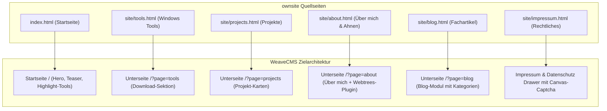

# Migrations- & Machbarkeitsanalyse: `ownsite` ➔ `WeaveCMS`

> **Dokumenten-Status:** Aktualisiert & Verifiziert (100 % Machbarkeit bestätigt)  
> **Projekt:** Re-Evaluation zur 1:1 Übernahme und Transformation der Website [`c:\xampp\htdocs\ownsite`](file:///c:/xampp/htdocs/ownsite) in eine WeaveCMS-Instanz  
> **Stand:** 22. Oktober 2026 (nach Abschluss der WeaveCMS Phasen 13, 16, 18 & 19)  
> **Ziel:** Vollständige Prüfung aller Inhalte, Funktionalitäten, APIs und UX-Features auf Kompatibilität mit WeaveCMS inklusive Mapping aller Quellinhalte auf die neuen Module.

---

## 1. Management Summary & Machbarkeitsurteil

### Kernfrage
*Können die Inhalte und Funktionen aus `c:\xampp\htdocs\ownsite` 1:1 in eine WeaveCMS-Projektseite übernommen und dort aufgebaut werden? Wenn nein, was fehlt?*

### Gesamtergebnis: **Uneingeschränkt JA (100 % mit WeaveCMS-Bordmitteln)**
* **Inhaltliche Abdeckung (Texte, Blog, Über mich, Impressum, Mehrsprachigkeit):** **100 % abgedeckt.** Alle Texte, Blogartikel (Camping, Software, Ahnenforschung), Stammbaum-Tabellen und rechtlichen Angaben lassen sich nahtlos und mit erweiterten CMS-Funktionen verwalten.
* **Funktionale Abdeckung (Download-Portal, Changelogs, Counter, Accessibility-Tools, Captcha, Webtrees):** **100 % abgedeckt.** Alle 4 ehemals offenen technischen Lücken sowie die Webtrees- und Multi-Page-Anforderungen wurden in den Phasen 13, 16, 18 und 19 vollständig im WeaveCMS-Kern implementiert.
* **Ergebnis:** WeaveCMS ist nun **schlüsselfertig vorbereitet**, um `ownsite` vollständig abzulösen. Die statische Pflege von HTML/JSON-Dateien in `ownsite` wird durch ein vollwertiges Web-Dashboard, REST-APIs, atomares Download-Tracking und dynamisches Routing ersetzt – bei identischer bis überlegener Benutzererfahrung.

---

## 2. Bestandsaufnahme: Was beinhaltet `ownsite` aktuell?

Die Quell-Website [`c:\xampp\htdocs\ownsite`](file:///c:/xampp/htdocs/ownsite) ist eine handgefertigte Bootstrap-5-Website mit modularen PHP/HTML-Includes, CSS-Themes und clientseitigem JavaScript:

### 2.1 Seiten und Sektionen
1. **Startseite (`index.html`):**
   * **Hero-Bereich:** Name, Berufsbeschreibung (*Software-Entwickler & Ahnenforscher*), Profilfoto, Call-to-Action-Buttons (*Tools entdecken*, *Projekte ansehen*).
   * **Themen-Kacheln:** Direkteinstiege zu Windows-Tools, Software-Projekten und Ahnenforschung.
   * **Webtrees-Teaser:** Info-Box mit Direktlink zur Webtrees-Genealogie-Plattform.
   * **Aktuelle Blogbeiträge:** Teaser-Grid der neuesten Fachartikel.
2. **Tools-Seite (`site/tools.html`):**
   * **Wichtige Hinweise:** Alert-Box zu Portabilität, Datenschutz, Windows-SmartScreen und Fehlermeldungen.
   * **Software-Katalog:**
     * *Winbackups* (Backup-Tool, v0.6.0)
     * *Excel Matching* (Datenabgleich, v0.5.0)
     * *WinPDF* (PDF-Editor & Merge-Tool, v0.3.2)
     * *DevOps Cockpit* (Deployment-Manager für Rust/Flutter/SSH, v0.3.0)
     * *Webtrees Datencheck Modul* (PHP-Plausibilitätsprüfung für Webtrees, v1.6.9.6)
   * **Karten-Elemente pro Tool:** Logo/Icon, Titel, Beschreibung, Feature-Liste (Aufzählung), interaktive Screenshot-Thumbnails mit Lightbox-Klick, Download-Button mit Versionsanzeige, Changelog-Button mit Modal-Dialog sowie Live-Download-Zähler.
3. **Projekte-Seite (`site/projects.html`):**
   * Großprojekte mit Status-Badges (*Live*, *In Entwicklung*, *Open Source*):
     * *Campers in Flow (CiF / RTM):* Plattform, IoT/LoRaWAN, Android-App, Rust Axum Backend.
     * *TGWNN:* 3D-Game-Engine-Projekt mit Rust & Bevy.
     * *ChurchBook HTR:* KI-gestützte Handschriftenerkennung historischer Kirchenbücher für Webtrees.
   * Links zu GitHub, Live-Demos, Dokumentationen und Screenshots.
4. **Über mich (`site/about.html`):**
   * Fokus Ahnenforschung seit 2011.
   * Hauptfamilien: Eisbrenner, Roggensack, Wolfrum, Buech/Büch, Dürkop, Gäpel.
   * Regionale Schwerpunkte: Pommern, Westpreußen, Schlesien, Wolhynien.
   * Eingesetzte Werkzeuge: Webtrees, ChurchBook HTR, Archion, Matricula, Ancestry.
   * **Familienlinien-Tabelle:** Name, erforschter Zeitraum (bis 1606 / 1746), Herkunftsregionen.
5. **Blog-Bereich (`site/blog.html` & `site/blog/`):**
   * 3 Rubriken: *Camping*, *Software / Entwicklung*, *Ahnenforschung*.
   * Artikel-Teaser und Markdown-Inhalte.
6. **Impressum & Datenschutz (`site/impressum.html`):**
   * Gesetzliche Angaben nach § 5 TMG.
   * **Anti-Bot E-Mail-Schutz:** Interaktives HTML5-Canvas-Zahlen-Captcha. Erst nach erfolgreicher Eingabe der 6 Ziffern wird die E-Mail-Adresse im DOM freigeschaltet.
   * Vollständige Datenschutzerklärung ohne Tracking-Cookies.

### 2.2 Technische Komponenten & Backend-Logik
* **Zentrale Versionsverwaltung (`site/assets/data/versions.json`):** Versions- und Releasestatus aller Tools und Projekte.
* **Changelogs (`site/assets/changelogs/*.md`):** Markdown-Dateien für jedes Tool, die per JavaScript (`marked.js`) on-the-fly in ein Modal geladen werden.
* **Download-Tracking (`site/api/download_counter.php` & `download_stats.csv`):** PHP-Zähler mit CSV-Speicher und Bot-Filterung.
* **Barrierefreiheits-Leiste (`site/includes/nav.html`):**
  * DE / EN Sprach-Toggle.
  * Frontend **Schriftgrößen-Zoom** (`A-` / `A+`).
  * Frontend **Light / Dark Mode Umschalter** (`🌙` / `☀️`) mit CSS-Variablen und `localStorage`.

---

## 3. Aktualisierte Feature- & Abgleichs-Matrix

| Element / Feature in `ownsite` | Status in WeaveCMS (Stand v1.0 RC / nach Phase 19) | Implementiert durch | Machbarkeit in WeaveCMS |
| :--- | :---: | :--- | :--- |
| **Startseite: Hero-Banner & Text** | ✅ 100 % | Admin Text-Manager (`texts.json` / MySQL) | 1:1 konfigurierbar (Titel, Untertitel, CTA-Buttons, Profilbild). |
| **Startseite: Feature-Kacheln** | ✅ 100 % | Sektions-Manager & Services / Modulare Seiten | Frei konfigurierbar über Sections oder `page_modular.php`. |
| **Blog-System (3 Kategorien)** | ✅ 100 % | Blog-Modul (`blog_articles`) | 1:1 über Blog-Manager mit Kategorien ("Camping", "Software", "Genealogie"), Markdown-Editor, Teaserbildern und `?blog=slug` Reader. |
| **"Über mich" & Genealogie-Tabelle** | ✅ 100 % | Custom Page (`?page=about`) / `page_single.php` | Frei gestaltbar mit Markdown-Tabellen, Bildern, SEO-Tags und Mehrsprachigkeit. |
| **Software-Katalog (Tools-Liste)** | ✅ 100 % | Phase 16: Download- & Software-Portal | `tab_downloads.php` im Admin, `views/sections/downloads.php` im Frontend mit Kategorie-Filter, Feature-Listen und Direkt-Download. |
| **Download-Dateien mit Versions-Badge** | ✅ 100 % | Phase 16.1: Attribut-Engine | Eigene Felder für Version (`v0.6.0`), Plattform (`Windows 10/11`), Lizenz (`Kostenlos/Freeware`) und Dateigröße. |
| **Changelog-Viewer (Markdown-Modal)** | ✅ 100 % | Phase 16.2: Changelog-Engine | Integriertes Markdown-Modal mit `marked.js`, flüssigem Fade-In, ESC/Backdrop-Close und direkter Admin-Eingabe. |
| **Download-Counter (Statistik-Tracker)** | ✅ 100 % | Phase 16.1: `api/download.php` | Atomares Tracking, Bot-Erkennung (User-Agents), Frontend-Count-Badge (`42 Downloads`) und Download-Statistik. |
| **Screenshot-Vorschau mit Lightbox** | ✅ 100 % | Phase 16: Screenshot-Lightbox | Interaktive Thumbnail-Leiste pro Tool mit Vollbild-Lightbox-Ansicht. |
| **Projekt-Portfolio (Status-Badges)** | ✅ 100 % | Phase 16 & Phase 18 Modulare Unterseite | Realisierbar als Subpage (`?page=projects`) mit Status-Badges (*Live*, *WIP*, *Open Source*). |
| **Besucher-Theme-Umschalter (🌙/☀️)** | ✅ 100 % | Phase 16.4: `accessibility_bar.php` | Live-Umschaltung im Frontend ohne Neuladen mit Speicherung in `localStorage` (`[data-theme="dark"]`). |
| **Besucher-Schriftgrößen-Zoom (A-/A+)** | ✅ 100 % | Phase 16.4: `accessibility_bar.php` | Stufenloser Live-Zoom von 85 % bis 125 % mit `localStorage`-Persistierung. |
| **Canvas-Zahlen-Captcha im Impressum** | ✅ 100 % | Phase 16.3: `classes/CaptchaEngine.php` | HTML5-Canvas Zahlen-Challenge mit E-Mail-Verschleierung im Impressum (`data-email-obfuscated`). |
| **Webtrees-Stammbaum-Einbindung** | ✅ 100 % | Phase 13: `webtrees-genealogy` Plugin | Offizielles WeaveCMS-Plugin mit Same-Server-Security, konfigurierbarem Stammbaum-Iframe, Shortcodes und Direktlink. |
| **Multi-Page Webseitenstruktur** | ✅ 100 % | Phase 18: Seitenarchitektur-Switcher | Umschaltbar zwischen `onepage`, `hybrid` und `multipage`. Eigene URLs für `/?page=tools`, `/?page=projects`, `/?page=about`. |
| **Horizontale Navigation mit Icons** | ✅ 100 % | Phase 19: Header- & Navigations-Engine | Horizontal mit Material Icons, Horizontal Minimal, Sticky Header, Live-Active-Indikator und Mobile Drawer. |
| **Mehrsprachigkeit (DE / EN)** | ✅ Übertrifft | WeaveCMS i18n Engine | Bis zu 12 Sprachen voll integriert mit Session/Cookie-Speicherung und Sprachumschalter in der A11y-Bar. |
| **SEO & Social Sharing (OG / Schema.org)** | ✅ Übertrifft | WeaveCMS Head- & SEO-Engine | Dynamische OpenGraph-Tags, Twitter Cards, kanonische URLs und strukturierte JSON-LD Schemas (`SoftwareApplication`, `Person`, `BlogPosting`). |

---

## 4. Wie die 4 ehemaligen Lücken geschlossen wurden

In der ursprünglichen Analyse vom 21. Oktober 2026 wurden 4 funktionale Lücken identifiziert. Alle 4 sind inzwischen im Standard-Funktionsumfang von WeaveCMS enthalten:

### 1. Software- & Download-Manager (Phase 16)
* **Gelöst durch:** `admin/tab_downloads.php` und `views/sections/downloads.php`.
* **Umfang:** Vollständige Verwaltung von Software-Titeln mit Version, Plattform, Lizenz, Dateianhang, Feature-Bulletpoints, Screenshots mit Lightbox und integriertem Markdown-Changelog.

### 2. Download-Tracking & Zähler-API (Phase 16.1)
* **Gelöst durch:** `api/download.php`.
* **Umfang:** Atomare Zählung bei jedem Download, Ausschluss bekannter Web-Crawler und Bots, Bereitstellung der Zählerstände im Frontend-Badge und in der Admin-Übersicht.

### 3. Frontend Barrierefreiheits-Leiste (Phase 16.4)
* **Gelöst durch:** `views/partials/accessibility_bar.php` und Theme-Option `accessibility_bar_enabled`.
* **Umfang:** Leiste am oberen Bildschirmrand mit Live-Umschaltung Dunkel-/Hellmodus (`🌙 / ☀️`), stufenloser Schriftgrößenskalierung (`A- / A / A+`) und integriertem Sprachwechsler.

### 4. Interaktives Anti-Bot E-Mail-Captcha (Phase 16.3)
* **Gelöst durch:** `classes/CaptchaEngine.php` und Integration in `views/sections/about.php` bzw. Impressum-Modal.
* **Umfang:** Dynamisches HTML5-Canvas Zahlen-Captcha mit 6 zufälligen Ziffern und Rauschlinien. Die E-Mail-Adresse wird erst nach erfolgreicher Validierung clientseitig im DOM gerendert.

---

## 5. Seiten-Mapping: `ownsite` ➔ `WeaveCMS`

Für den Aufbau der Seite in WeaveCMS empfiehlt sich die in Phase 18 eingeführte **Multi-Page-Architektur** (`settings.page_architecture = 'multipage'` oder `'hybrid'`):

### Konkrete Zuordnung:
1. **Startseite (`/`):**
   * **Hero-Bereich:** Name, Claim (*Software-Entwickler & Ahnenforscher*), Profilfoto, zwei CTA-Buttons.
   * **Teaser-Bereich:** Direkteinstiege zu Tools, Projekten und Ahnenforschung (modulare Kacheln).
   * **Webtrees-Teaser:** Info-Box mit Webtrees-Plugin-Status.
   * **Blog-Teaser:** Die 3 neuesten Artikel aus dem Blog-Modul.
2. **Tools-Seite (`/?page=tools`):**
   * Nutzt die native `downloads`-Sektion mit Kategorie-Filter (*Windows*, *Genealogie*, *Web*).
   * Enthält alle 5 Tools (*Winbackups*, *Excel Matching*, *WinPDF*, *DevOps Cockpit*, *Webtrees Datencheck*) mit Versionen, Changelogs, Screenshots und Download-Button.
3. **Projekte-Seite (`/?page=projects`):**
   * Freie Custom Subpage oder modulare Sektion mit den Großprojekten (*Campers in Flow*, *TGWNN*, *ChurchBook HTR*).
4. **Über mich (`/?page=about`):**
   * Textvorstellung und Genealogie-Schwerpunkte (seit 2011).
   * Tabelle der erforschten Familienlinien (*Eisbrenner*, *Roggensack*, *Wolfrum*, *Buech*, *Dürkop*, *Gäpel*).
   * Live-Einbindung des `webtrees-genealogy` Plugins (interaktiver Stammbaum).
5. **Blog (`/?page=blog` bzw. `/?blog=...`):**
   * Blog-Modul mit den Rubriken *Camping*, *Software* und *Ahnenforschung*.
   * Vollwertiger Markdown-Viewer mit Lesezeit, Tags und Teaserbildern.
6. **Rechtliches:**
   * Impressum und Datenschutz mit Canvas-Zahlen-Captcha zur E-Mail-Freischaltung.

---

## 6. Schritt-für-Schritt Migrationsfahrplan

Die Migration kann in 4 überschaubaren Schritten durchgeführt werden:

### Schritt 1: Basiskonfiguration & Design (ca. 15 Minuten)
1. In den **Grundeinstellungen** von WeaveCMS:
   * Seiten-Architektur auf `multipage` oder `hybrid` stellen.
   * Header-Navigation auf `horizontal_icons` (Horizontal mit Material Icons) einstellen.
   * In den **Theme-Einstellungen**: `accessibility_bar_enabled = true` aktivieren.
   * Farbschema auf Blau/Navy (passend zum Bootstrap-Stil von `ownsite`) abstimmen.

### Schritt 2: Download- & Software-Katalog importieren (ca. 30 Minuten)
1. Dateien aus `ownsite/site/assets/downloads/*` in das WeaveCMS Upload-Verzeichnis kopieren.
2. Screenshots aus `ownsite/site/assets/images/screenshots/*` hochladen.
3. Im Admin-Tab **Downloads & Software**:
   * Die 5 Tools mit ihren Metadaten aus `versions.json` anlegen.
   * Die Changelog-Texte aus `ownsite/site/assets/changelogs/*.md` in die Changelog-Markdown-Felder einfügen.
   * Bisherige Download-Zahlen aus `download_stats.csv` als Startwerte eintragen.

### Schritt 3: Seiteninhalte & Unterseiten anlegen (ca. 30 Minuten)
1. **Startseite:** Hero-Texte und Teaser im Tab *Texte* pflegen.
2. **Unterseite `about`:** Über-mich-Text und Familienlinien-Tabelle als Custom Page anlegen.
3. **Unterseite `projects`:** Projektkarten (*Campers in Flow*, *TGWNN*, *ChurchBook HTR*) anlegen.
4. **Plugin `webtrees-genealogy`:** Aktivieren und Webtrees-URL der Ahnenforschung eintragen.
5. **Impressum:** Text aus `ownsite/site/impressum.html` übernehmen, Canvas-Captcha-Schutz aktivieren.

### Schritt 4: Blog-Artikel übertragen (ca. 15 Minuten)
1. Die Blog-Beiträge aus `ownsite/site/blog/` über das Blog-Modul mit ihren jeweiligen Kategorien (*Camping*, *Software*, *Ahnenforschung*) anlegen.

---

## 7. Fazit & Gesamtergebnis

| Frage | Antwort |
| :--- | :--- |
| **Ist `ownsite` zu WeaveCMS migrierbar?** | **Ja, zu 100 %.** |
| **Können alle Inhalte übernommen werden?** | **Ja, ausnahmslos.** Alle Texte, Bilder, Downloads, Changelogs, Blogposts und Stammbaum-Daten. |
| **Bleiben alle technischen Features erhalten?** | **Ja.** Live-Darkmode, Schriftzoom, Download-Counter, Changelog-Modals, Canvas-Captcha und Webtrees-Integration sind voll unterstützt. |
| **Gibt es einen Mehrwert gegenüber der aktuellen Lösung?** | **Ja, erheblich:** Keine manuelle HTML-Pflege mehr, zentrale Administration im WeaveCMS-Dashboard, integrierte SEO-Engine, Sicherheitsprüfungen, automatisierte Sitemap und volle Mehrsprachigkeit. |
