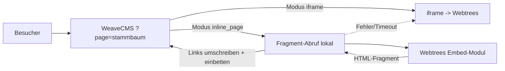

# Webtrees-Integration ohne iframe (eigene Seite) – Analyse & Konzept

> **Status:** Konzept / Machbarkeitsprüfung – **noch nicht implementiert**.
> **Betrifft:** Plugin `plugins/webtrees-genealogy` (v1.0.0)
> **Ziel:** Optional die Webtrees-Inhalte **ohne `<iframe>`** direkt als eigene WeaveCMS-Seite (`?page=stammbaum`) darstellen.

> [!NOTE]
> Aussagen zum **WeaveCMS-Plugin** wurden am Quellcode geprüft. Aussagen zu **Webtrees-Interna**
> (Modul-/Theme-System, Sessions, CSRF, Asset-Auslieferung) beruhen auf allgemeinem Wissen über Webtrees
> und müssen vor der Umsetzung gegen die **tatsächlich installierte Webtrees-Version** verifiziert werden
> (siehe Abschnitt 9, Spike).

---

## 1. Ausgangslage (Ist-Zustand)

| Aspekt | Ist-Zustand | Quelle |
|---|---|---|
| Einbettung | Ausschließlich `<iframe>` (Modus `interactive_iframe`) oder Vorschaukarte mit Link (`family_preview`) | `views/tree_embed.php` |
| Server-seitiger Abruf von Webtrees | **Keiner** – es wird nur eine URL zusammengesetzt | `views/tree_embed.php` |
| Webtrees-Standort | Nur **gleicher Server**, relativer Pfad (z. B. `/webtrees`); externe URLs werden abgewiesen | `plugin.php` (`plugin_validate_config_*`) |
| URL-Schema | `<Pfad>/tree/<Baum>[/individual/<ID>][?token=…]` | `views/tree_embed.php` |
| Darstellung im CMS | Sektion `webtrees` (Startseite) und Shortcode `[webtrees …]` | `plugin.php` |
| Eigene Seite | Nicht vorhanden; nur Sektion bzw. Shortcode in Einzelseiten | – |
| Einstellungen | Pfad, Baum-ID, Modus, Startperson, Höhe, Token, Sektionsoptionen | `admin/settings.php` |

Relevante Plugin-Hooks (bereits genutzt): `admin_render_plugin_settings_<slug>`, `content_shortcodes`,
`registered_sections`, `visible_sections`, `plugin_config_saved_<slug>`, `frontend_render_custom_section`,
`plugin_validate_config_<slug>`.

---

## 2. Anforderung

1. Webtrees-Inhalte sollen **optional** ohne iframe erscheinen.
2. Darstellung als **eigene Seite** (Multi-Page-Routing aus Phase 18).
3. Bestehende Modi (`interactive_iframe`, `family_preview`) bleiben **unverändert** nutzbar (Abwärtskompatibilität).
4. Sicherheitsvorgabe „nur lokaler Server" bleibt bestehen.

---

## 3. Warum „einfach einbinden" nicht funktioniert

Webtrees ist eine **eigenständige PHP-Anwendung** mit eigenem Front-Controller, Routing, Session-Handling,
Template-Engine, Assets (CSS/JS) und CSRF-Schutz. Eine Seite ohne iframe bedeutet daher, dass entweder
Webtrees **in** den WeaveCMS-Request gezogen wird oder dass WeaveCMS **dessen Ausgabe** übernimmt.
Beides berührt folgende Problemfelder:

| Problemfeld | Beschreibung |
|---|---|
| **Sessions & Header** | Beide Systeme starten eigene Sessions und senden Header/Cookies. Gemeinsame Ausführung im selben PHP-Prozess kann kollidieren. |
| **Routing & Links** | Webtrees erzeugt absolute Pfade (`/webtrees/tree/...`). Diese müssten auf WeaveCMS-URLs umgeschrieben werden. |
| **CSS-Kollisionen** | Webtrees liefert ein eigenes Framework-CSS. Dieses würde WeaveCMS-Styles überschreiben und umgekehrt. |
| **JavaScript** | Webtrees-Seiten laden eigene Bibliotheken und AJAX-Aufrufe mit festen URLs. |
| **Formulare & CSRF** | Suche, Login, Filter nutzen POST/CSRF-Token. Diese müssen korrekt durchgereicht werden. |
| **Anmeldung** | Angemeldete Webtrees-Benutzer benötigen ihre Webtrees-Session-Cookies pro Besucher. |
| **Caching & Performance** | Jeder Seitenaufruf löst einen zusätzlichen Webtrees-Request aus. |

---

## 4. Lösungsvarianten

### Variante A – Direktes `include` von Webtrees in den WeaveCMS-Request
- **Idee:** Webtrees-`index.php` im selben PHP-Prozess ausführen.
- **Bewertung:** ❌ **Nicht empfohlen.** Hohe Kollisionsgefahr (Sessions, Header, Autoloader, Output-Buffering), schwer wartbar, bricht bei Webtrees-Updates.

### Variante B – Server-seitiger Abruf (HTTP-Proxy) mit Inhaltsextraktion
- **Idee:** WeaveCMS ruft die lokale Webtrees-URL per cURL ab, extrahiert den Content-Bereich aus dem HTML und schreibt Links um.
- **Vorteile:** Kein Eingriff in Webtrees nötig.
- **Nachteile:** HTML-Parsing ist fragil (Aufbau ändert sich mit Webtrees-Versionen); CSS/JS-Kollisionen; Formulare, AJAX und Cookies aufwendig; Link-Umschreibung unvollständig möglich.
- **Bewertung:** ⚠️ Machbar als **Notlösung**, aber wartungsintensiv.

### Variante C – Webtrees-Modul/-Theme „Embed" + Abruf durch WeaveCMS (empfohlen)
- **Idee:** Ein kleines **Webtrees-Modul/-Theme** liefert Seiten **ohne** Kopfzeile, Menü und Footer (reines Content-Fragment, eigener CSS-Namensraum). WeaveCMS ruft dieses Fragment serverseitig ab und bettet es in eine eigene Seite ein.
- **Vorteile:** Stabile Schnittstelle (wir kontrollieren das Fragment-Format); CSS-Kapselung möglich; Link-Umschreibung gezielt über definierte Marker; unabhängig von HTML-Änderungen des Standard-Themes.
- **Nachteile:** Erfordert Installation eines Webtrees-Moduls; Pflege bei größeren Webtrees-Updates.
- **Bewertung:** ✅ **Empfohlen** für „echte" Integration ohne iframe.

### Variante D – Nahtloses same-origin-iframe (Zwischenlösung)
- **Idee:** iframe bleibt, wirkt aber „nahtlos": automatische Höhenanpassung (same-origin, daher direkt per JS möglich), rahmenlos, Design über Modul/CSS angeglichen.
- **Vorteile:** Geringer Aufwand, robust, volle Webtrees-Funktionalität inkl. Login/Formulare.
- **Nachteile:** Technisch weiterhin ein iframe (Deep-Links/SEO eingeschränkt).
- **Bewertung:** ✅ Sinnvoller **Schritt 1**, auch wenn Variante C später folgt.

### Vergleich

| Kriterium | A: include | B: Proxy | C: Embed-Modul | D: nahtloses iframe |
|---|---|---|---|---|
| Kein iframe | ✅ | ✅ | ✅ | ❌ |
| Aufwand | hoch | mittel–hoch | mittel | gering |
| Stabilität bei Updates | ❌ | ⚠️ | ✅ | ✅ |
| CSS-Kapselung | ❌ | ❌ | ✅ | ✅ (isoliert) |
| Login/Formulare | ❌ | ⚠️ | ⚠️ | ✅ |
| Eingriff in Webtrees | nein | nein | **ja (Modul)** | optional |
| Empfehlung | ❌ | ⚠️ | ✅ | ✅ (Stufe 1) |

---

## 5. Empfohlenes Zielbild (stufenweise)

**Stufe 1 – Nahtloses iframe (Variante D)**
Neuer Modus `seamless_iframe`: rahmenlos, automatische Höhe, eigene Seite `?page=stammbaum`.

**Stufe 2 – Inline-Seite ohne iframe (Variante C)**
Neuer Modus `inline_page`: WeaveCMS bindet das Fragment aus dem Webtrees-Embed-Modul serverseitig ein.
Fällt automatisch auf `seamless_iframe` zurück, wenn das Modul nicht erreichbar ist.

---

## 6. Detailkonzept (Stufe 2, Variante C)

### 6.1 Plugin-Konfiguration (Erweiterung)

| Feld | Werte | Standard | Beschreibung |
|---|---|---|---|
| `embed_mode` | `interactive_iframe`, `family_preview`, **`seamless_iframe`**, **`inline_page`** | `interactive_iframe` | Erweiterung der bestehenden Werte (Whitelist in `plugin_validate_config_*` anpassen) |
| `page_enabled` | bool | `false` | Eigene Seite aktivieren |
| `page_slug` | `[a-z0-9-]+` | `stammbaum` | URL-Slug der Seite |
| `page_title` / `page_subtitle` | Text | wie Sektion | Überschriften |
| `fragment_endpoint` | lokaler Pfad | `/webtrees/embed` | Pfad zum Embed-Modul (nur lokal, gleiche Validierung wie `webtrees_path`) |
| `fragment_timeout` | 1–15 s | `5` | Timeout für den lokalen Abruf |
| `fragment_cache_ttl` | 0–3600 s | `300` | Cache für Gast-Seiten (0 = aus) |
| `fallback_to_iframe` | bool | `true` | Bei Fehlern auf nahtloses iframe zurückfallen |

> Alle neuen Felder müssen in `plugin_validate_config_webtrees-genealogy` **whitelisted und bereinigt** werden
> (Slug-Regex, Pfad-Normalisierung wie bisher, Zahlenbereiche).

### 6.2 Routing

- Registrierung einer eigenen Seite über die bestehende Sektions-/Seiten-Logik (Phase 18, Multi-Page: `?page=<slug>`).
- Webtrees-interne Navigation wird über **einen** Query-Parameter abgebildet, z. B.
  `?page=stammbaum&wt=/tree/baum1/individual/I1`.
- **Pfad-Whitelist:** `wt` darf nur mit `/tree/` (und ggf. weiteren explizit freigegebenen Präfixen) beginnen, keine `..`, keine Schemata, keine absoluten URLs.

### 6.3 Fragment-Abruf (serverseitig)

1. Zielpfad aus `wt` validieren (Whitelist, siehe oben).
2. Abruf per cURL **ausschließlich** an `http(s)://<eigener Host>` + `webtrees_path` (kein frei wählbarer Host → **SSRF-Schutz**).
3. Timeout, Größenlimit (z. B. 2 MB) und Redirect-Begrenzung (nur innerhalb des Webtrees-Pfads).
4. Antwort muss das erwartete Fragment-Format liefern (Marker), sonst Fallback.
5. Optionaler Cache (Dateicache) nur für **nicht angemeldete** Anfragen.

### 6.4 Link- und Formular-Umschreibung

- Das Embed-Modul markiert interne Links (z. B. `data-wt-href`), damit WeaveCMS **ohne** fragiles HTML-Parsing umschreiben kann.
- Links → `?page=<slug>&wt=<pfad>`.
- Formulare (Suche, Filter): Methode `GET` bevorzugt; POST-Formulare nur mit CSRF-Durchreichung oder Fallback auf iframe.
- Statische Assets des Moduls werden über den Webtrees-Pfad geladen, **CSS ist auf einen Wrapper (`.wt-embed`) gekapselt**.

### 6.5 Authentifizierung

- **Phase 1:** Nur öffentlicher Gastzugriff (optional bestehendes `embed_token`).
- **Später (optional):** Durchreichen der Webtrees-Cookies je Besucher. Hoher Aufwand und Sicherheitsrisiko → nur wenn zwingend nötig; sonst bei geschützten Bäumen **automatisch iframe/Direktlink**.

### 6.6 Webtrees-Embed-Modul (neu, außerhalb von WeaveCMS)

- Eigenes Modul im Webtrees-Verzeichnis `modules_v4/` (genauer Aufbau je nach Version zu prüfen).
- Liefert für freigegebene Routen nur das **Content-Fragment** (ohne `<html>`, Header, Menü, Footer).
- Ausgabe mit stabilem Wrapper `
`.
- Eigenes, gekapseltes CSS; kein globales Bootstrap-Override.
- Muss **keine** Daten ausliefern, die ein Gast im normalen Webtrees nicht sehen dürfte (Datenschutz/Privacy-Einstellungen von Webtrees bleiben maßgeblich).

---

## 7. Sicherheit & Datenschutz

| Risiko | Gegenmaßnahme |
|---|---|
| **SSRF** (WeaveCMS ruft fremde Ziele ab) | Host fest = eigener Host; nur validierter Webtrees-Pfad; keine Weiterleitung nach außen |
| **Path Traversal / Open Redirect** | Strikte Whitelist für `wt`; `..` und Schemata verbieten |
| **XSS durch Fragment** | Fragment stammt aus eigenem Modul; zusätzlich Allowlist-Sanitizing (Skripte entfernen) oder striktes CSP |
| **Datenschutz** | Webtrees-Privacy-Regeln bleiben verbindlich; Gäste sehen nur freigegebene Daten; Cache nur für Gast-Antworten |
| **CSRF bei Formularen** | GET-Formulare bevorzugen; POST nur mit durchgereichtem Token |
| **DoS durch Abruf** | Timeout, Größenlimit, Cache, Rate-Limit |
| **Session-Leaks** | Keine Weitergabe von WeaveCMS-Admin-Cookies an Webtrees |

---

## 8. Umsetzungsplan

| # | Aufgabe | Aufwand (grob) |
|---|---|---|
| 1 | Konfigurationsfelder & Validierung erweitern (`plugin.php`, `admin/settings.php`) | klein |
| 2 | Neuer Modus `seamless_iframe` (rahmenlos, Auto-Höhe, eigene Seite `?page=<slug>`) | klein–mittel |
| 3 | Eigene Seite/Route im Plugin registrieren (Anbindung an Phase-18-Routing) | mittel |
| 4 | Webtrees-Embed-Modul entwickeln (separates Artefakt) | mittel |
| 5 | Fragment-Abruf inkl. Pfad-Whitelist, SSRF-Schutz, Timeout, Cache | mittel |
| 6 | Link-/Formular-Umschreibung, CSS-Kapselung | mittel |
| 7 | Fallback-Logik & Fehleranzeige für Admin | klein |
| 8 | Dokumentation, Tests, Abnahme | klein–mittel |

### Abnahmekriterien
- Seite `?page=stammbaum` zeigt Stammbaum **ohne iframe** (im DOM kein `<iframe>`).
- Navigation innerhalb des Baums funktioniert (Personen, Register, Suche) ohne Verlassen der WeaveCMS-Seite.
- Bei deaktiviertem/fehlendem Modul erscheint automatisch das nahtlose iframe (kein Fehlerbild).
- Alte Modi liefern identische Ausgabe wie bisher.
- Keine Manipulation des Webtrees-Pfads über `wt` möglich (Negativtests: `../`, `http://…`, `//host`).
- Privacy: Gast sieht keine Daten, die auch in Webtrees nicht öffentlich wären.

---

## 9. Offene Punkte / Spike vor der Umsetzung

Vor der Entwicklung sollte ein kurzer technischer Spike (ca. 0,5–1 Tag) klären:

1. **Welche Webtrees-Version** ist installiert und wie ist das Modul-/Theme-System dieser Version aufgebaut?
2. Ist Webtrees **öffentlich (Gastzugriff)** oder müssen sich Besucher anmelden?
3. Darf ein **Webtrees-Modul** installiert werden? (Voraussetzung für Variante C)
4. Soll das Design **an WeaveCMS angepasst** werden oder reicht ein neutrales Webtrees-Aussehen?
5. Welche Webtrees-Seiten werden benötigt (nur Stammbaum/Personenseiten oder auch Berichte, Suche, Listen)?
6. Reichen **GET-basierte** Interaktionen, oder werden POST-Formulare zwingend benötigt?
7. Werden **Webtrees-Cookies/Login** pro Besucher benötigt (wirkt stark auf Aufwand und Sicherheit)?

---

## 10. Abgrenzung & Alternativen

- **Reine Link-Lösung:** Webtrees bleibt eigenständig, WeaveCMS verlinkt nur (Modus `family_preview` existiert bereits).
- **Gemeinsames Theme:** Webtrees-Theme im WeaveCMS-Look, Webtrees auf eigener Subdomain/Pfad, Navigation verlinkt hin und zurück – geringster Aufwand, kein Seitenwechsel-Effekt vermeidbar.
- **Export statt Live-Einbettung:** Statische Berichte/Diagramme aus Webtrees exportieren und als Content einbinden – nur für Teilbereiche sinnvoll.

---

## 11. Empfehlung (Kurzfassung)

1. **Stufe 1** umsetzen: `seamless_iframe` + eigene Seite (schnell, robust).
2. **Spike** zu Webtrees-Version, Modulpflicht, Gastzugriff durchführen.
3. Bei positivem Ergebnis **Stufe 2** (`inline_page` mit Webtrees-Embed-Modul) umsetzen.
4. Direktes `include` (Variante A) **nicht** verfolgen.

---

## 12. Verwandte Dateien

- `plugins/webtrees-genealogy/plugin.php`
- `plugins/webtrees-genealogy/plugin.json`
- `plugins/webtrees-genealogy/views/tree_embed.php`
- `plugins/webtrees-genealogy/admin/settings.php`
- `libs/docs/roadmap.md` (Phase 18: Multi-Page-Architektur)
- `libs/docs/features.md`
