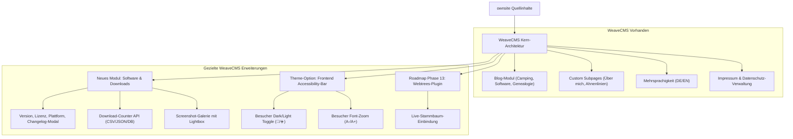

# Migrations- & Machbarkeitsanalyse: `ownsite` ➔ `WeaveCMS`

> **Dokumenten-Status:** Fertiggestellt  
> **Projekt:** Analyse zur 1:1 Übernahme und Transformation der Website [`c:\xampp\htdocs\ownsite`](file:///c:/xampp/htdocs/ownsite) in eine WeaveCMS-Instanz  
> **Datum:** 21. Oktober 2026  
> **Ziel:** Vollständige Prüfung aller Inhalte, Funktionalitäten, APIs und UX-Features auf Kompatibilität mit WeaveCMS inklusive Identifikation aller funktionellen Lücken ("Gaps") und Bereitstellung eines konkreten Migrationsplans.

---

## 1. Management Summary & Machbarkeitsurteil

### Kernfrage
*Können die Inhalte und Funktionen aus `c:\xampp\htdocs\ownsite` später 1:1 in eine WeaveCMS-Projektseite übernommen und dort aufgebaut werden? Wenn nein, was fehlt?*

### Gesamtergebnis: **Bedingt Ja (ca. 85 % mit WeaveCMS-Bordmitteln / 100 % mit gezielten Erweiterungen)**
* **Inhaltliche Abdeckung (Texte, Blog, Über mich, Impressum, Mehrsprachigkeit):** **100 % machbar.** Alle Texte, Blogartikel (Camping, Software, Ahnenforschung), Stammbaum-Tabellen und rechtlichen Angaben lassen sich nahtlos in WeaveCMS übertragen.
* **Funktionale 1:1 Deckung (Download-Portal, Changelogs, Counter, Accessibility-Tools):** **ca. 70 % out-of-the-box.** Für eine **exakte 1:1 Benutzererfahrung** fehlen WeaveCMS aktuell 4 spezifische technische Komponenten (Download-Counter, Changelog-Modal-Drawer, Besucher-Theme-Umschalter im Frontend sowie das interaktive E-Mail-Canvas-Captcha).
* **Entwicklungsempfehlung:** Das Projekt eignet sich hervorragend als Vorzeige-Einsatz für WeaveCMS (Softwareentwickler & Genealoge). Die fehlenden Komponenten lassen sich entweder über das in Phase 13 geplante Plugin-System oder als Kern-Erweiterung "Software- & Download-Manager" sauber integrieren.

---

## 2. Bestandsaufnahme: Was beinhaltet `ownsite` aktuell?

Die Codebasis [`c:\xampp\htdocs\ownsite`](file:///c:/xampp/htdocs/ownsite) ist eine handgefertigte, schlanke Bootstrap-5-Website mit modularen PHP/HTML-Includes, CSS-Themes und clientseitigem JavaScript:

### 2.1 Seiten und Sektionen
1. **Startseite (`index.html`):**
   * **Hero-Bereich:** Name, Berufsbeschreibung (*Software-Entwickler & Ahnenforscher*), Profilfoto, zwei Call-to-Action-Buttons (*Tools entdecken*, *Projekte ansehen*).
   * **Themen-Kacheln:** Direkteinstiege zu Windows-Tools, Software-Projekten und Ahnenforschung.
   * **Webtrees-Teaser:** Info-Box mit Direktlink zur Webtrees-Genealogie-Plattform.
   * **Aktuelle Blogbeiträge:** Teaser-Grid der neuesten Fachartikel.
2. **Tools-Seite (`site/tools.html`):**
   * **Wichtige Hinweise:** Alert-Box zu Portabilität, Datenschutz, Windows-SmartScreen und Fehlermeldungen.
   * **Software-Katalog:**
     * *Winbackups* (Backup-Tool, v0.6.0)
     * *Excel Matching* (Datenabgleich, v0.5.0)
     * *WinPDF* (PDF-Editor & Merge-Tool, v0.3.2)
     * *DevOps Cockpit* (Deployment-Manager für Rust/Flutter/SSH, v0.3.0)
     * *Webtrees Datencheck Modul* (PHP-Plausibilitätsprüfung für Webtrees, v1.6.9.6)
   * **Karten-Elemente pro Tool:** Logo/Icon, Titel, Beschreibung, Feature-Liste (Aufzählung), interaktive Screenshot-Thumbnails mit Lightbox-Klick, Download-Button mit Versionsanzeige, Changelog-Button mit Modal-Dialog sowie Live-Download-Zähler.
3. **Projekte-Seite (`site/projects.html`):**
   * Großprojekte mit Status-Badges (*Live*, *In Entwicklung*, *Open Source*):
     * *Campers in Flow (CiF / RTM):* Plattform, IoT/LoRaWAN, Android-App, Rust Axum Backend.
     * *TGWNN:* 3D-Game-Engine-Projekt mit Rust & Bevy.
     * *ChurchBook HTR:* KI-gestützte Handschriftenerkennung historischer Kirchenbücher für Webtrees.
   * Links zu GitHub, Live-Demos, Dokumentationen und Screenshots.
4. **Über mich (`site/about.html`):**
   * Fokus Ahnenforschung seit 2011.
   * Hauptfamilien: Eisbrenner, Roggensack, Wolfrum, Buech/Büch, Dürkop, Gäpel.
   * Regionale Schwerpunkte: Pommern, Westpreußen, Schlesien, Wolhynien.
   * Eingesetzte Werkzeuge: Webtrees, ChurchBook HTR, Archion, Matricula, Ancestry.
   * **Familienlinien-Tabelle:** Name, erforschter Zeitraum (bis 1606 / 1746), Herkunftsregionen.
5. **Blog-Bereich (`site/blog.html` & `site/blog/`):**
   * 3 Rubriken: *Camping*, *Software / Entwicklung*, *Ahnenforschung*.
   * Artikel-Teaser und Markdown-Inhalte.
6. **Impressum & Datenschutz (`site/impressum.html`):**
   * Gesetzliche Angaben nach § 5 TMG.
   * **Anti-Bot E-Mail-Schutz:** Interaktives HTML5-Canvas-Zahlen-Captcha. Erst nach erfolgreicher Eingabe der 6 Ziffern wird die E-Mail-Adresse im DOM freigeschaltet.
   * Vollständige Datenschutzerklärung ohne Tracking-Cookies.

### 2.2 Technische Komponenten & Backend-Logik
* **Zentrale Versionsverwaltung (`site/assets/data/versions.json`):** JSON-Datei mit Versionen und Releasedaten aller Tools und Projekte.
* **Changelogs (`site/assets/changelogs/*.md`):** Markdown-Dateien für jedes Tool, die per JavaScript (`marked.js`) on-the-fly in ein Bootstrap-Modal geladen werden.
* **Download-Tracking (`site/api/download_counter.php` & `download_stats.csv`):** Serverseitiges PHP-Skript, das beim Klick auf den Download-Button aufgerufen wird, die Zählerstände in einer CSV speichert und im JSON-Format zurückliefert.
* **Barrierefreiheits-Leiste (`site/includes/nav.html`):**
  * DE / EN Sprach-Toggle (`toggleLanguage()`).
  * Frontend **Schriftgrößen-Zoom** (`A-` / `A+`).
  * Frontend **Light / Dark Mode Umschalter** (`🌙` / `☀️`) mit CSS-Variablen (`themes.css`) und `localStorage`.

---

## 3. Detaillierte Feature- & Abgleichs-Matrix

| Element / Feature in `ownsite` | In WeaveCMS (Stand v0.8.5) vorhanden? | Status | Machbarkeit / Lösung in WeaveCMS |
| :--- | :--- | :---: | :--- |
| **Startseite: Hero-Banner & Text** | Ja (`texts.json` / Admin Text-Tab) | ✅ 100 % | 1:1 über Text-Manager konfigurierbar (Titel, Untertitel, CTA-Buttons). |
| **Startseite: Feature-Kacheln** | Ja (Services / Sektionen) | ✅ 100 % | Über Sektionen oder Custom Subpages darstellbar. |
| **Blog-System (3 Kategorien)** | Ja (`blog_articles` Modul) | ✅ 100 % | 1:1 über das Blog-Modul abbildbar. Kategorien "Camping", "Software", "Ahnenforschung", Markdown-Editor, Teaserbilder und `?blog=slug` Reader. |
| **"Über mich" & Genealogie-Tabelle** | Ja (Custom Subpage `?page=about`) | ✅ 100 % | Über den neuen Subpage-Drawer mit Tabellen-Markdown, SEO-Feldern und Mehrsprachigkeit 1:1 umsetzbar. |
| **Impressum & DSGVO-Text** | Ja (Impressum- & DSGVO-Drawer) | ✅ 100 % | Vollständige Textfelder für § 5 TMG und Datenschutz bereits integriert. |
| **Mehrsprachigkeit (DE / EN)** | Ja (WeaveCMS i18n System) | ✅ Übertrifft | WeaveCMS beherrscht bis zu 12 Sprachen mit Cookie/Session-Speicher. `ownsite` nutzt 2 Sprachen. |
| **SEO & Social Sharing (OG / Schema.org)** | Ja (WeaveCMS Head-Engine) | ✅ Übertrifft | WeaveCMS erzeugt dynamisch OpenGraph, Twitter-Cards, Breadcrumbs und FAQ Schema.org. |
| **Software-Katalog (Tools-Liste)** | Basis vorhanden (`downloads` Sektion für PDFs) | 🟡 70 % | Basis-Download-Bereich existiert bereits in WeaveCMS (`tab_downloads.php`). Für vollwertige Software fehlen optionale Profi-Felder (wird in Roadmap Phase 16 modular erweitert). |
| **Download-Dateien mit Versions-Badge** | Geplant in Phase 16 | 🟡 Phase 16 | Basis-Upload existiert; optionale Felder für Version (`v0.6.0`), Plattform & Lizenz werden in Phase 16 als optionale Attribute ergänzt. |
| **Changelog-Viewer (Markdown-Modal)** | Geplant in Phase 16 | 🟡 Phase 16 | Optionale Einbindung von Markdown-Changelogs mit flüssigem Frontend-Modal/Drawer wird in Phase 16 in das Download-Modul integriert. |
| **Download-Counter (Statistik-Tracker)** | Geplant in Phase 16 | 🟡 Phase 16 | Klick-Tracking-Proxy (`api/download.php?id=...`) mit atomarem Zähler und Frontend-Badge wird direkt in das Download-Modul integriert. |
| **Screenshot-Vorschau mit Lightbox** | Ja (Galerie-Lightbox existiert) | 🟡 70 % | Galerie-Lightbox ist vorhanden, ist aber an das Galerie-Modul gebunden und nicht frei in Tool-Karten eingebettet. |
| **Projekt-Portfolio (Status-Badges)** | Teilweise | 🟡 60 % | Kann über Custom Pages gelöst werden; dedizierte Status-Tags ("WIP", "Live") fehlen als Datenfeld. |
| **Besucher-Theme-Umschalter (🌙/☀️)** | Nein (Nur Admin-Theme-Einstellung) | ❌ Fehlt | WeaveCMS verwaltet Themes über den Adminbereich. Besucher im Frontend haben keinen Live-Umschalter. |
| **Besucher-Schriftgrößen-Zoom (A-/A+)** | Nein (Nur Admin-Skalierung) | ❌ Fehlt | In WeaveCMS stellt der Admin die Skalierung (95 %, 100 %, 108 %) ein; Besucher können sie nicht selbst toggeln. |
| **Canvas-Zahlen-Captcha im Impressum** | Nein | ❌ Fehlt | WeaveCMS schützt das Kontaktformular via Symbol-Captcha, bietet aber kein Canvas-Captcha zur E-Mail-Verschleierung im Impressum. |
| **Webtrees-Stammbaum-Einbindung** | Geplant (Phase 13 Plugin) | 🟡 In Vorbereitung | Aktuell als Teaser-Link möglich; native Plugin-Integration folgt in Roadmap Phase 13. |

---

## 4. Detaillierte Lücken-Analyse: Was fehlt in WeaveCMS für 1:1?

Um `ownsite` wirklich **ohne funktionelle Einbußen** auf WeaveCMS zu betreiben, müssen folgende 4 Funktionsblöcke adressiert werden:

### 1. Fehlendes Modul: "Software- & Download-Manager"
* **Was `ownsite` hat:**
  Eine strukturierte Übersicht von Programmen mit:
  * Anwendungs-Icon & Titel
  * Kurzbeschreibung & Feature-Bulletpoints
  * Screenshot-Galerie (2 Thumbnails pro App, Lightbox bei Klick)
  * Download-Button mit automatischer Versionsanzeige (`Download v0.6.0`)
  * `📜 Changelog`-Button, der die Versionshistorie aus Markdown liest
  * Badge mit Live-Download-Zahlen (`42 Downloads`)
* **Aktueller WeaveCMS-Zustand:**
  WeaveCMS verfügt über Module für Bilder (Galerie), Termine (Kurse), Rückblicke (Impressionen), Blog-Beiträge und freie Subpages, jedoch **nicht** über ein natives Download-Management.
* **Lösungsweg:**
  Einführung einer neuen Sektion bzw. eines Plugins `downloads` (analog zu `blog_articles` oder `courses`).

### 2. Download-Tracking & Zähler-API
* **Was `ownsite` hat:**
  Ein serverseitiges Skript `api/download_counter.php`, das beim Klick auf den Download-Button:
  * Den Zähler in `download_stats.csv` atomar inkrementiert,
  * Die Gesamtzahl an Klicks liefert,
  * Bots ignoriert und Download-Statistiken bereitstellt.
* **Aktueller WeaveCMS-Zustand:**
  WeaveCMS hat keine Tracking-Endpunkte für Dateizugriffe oder Klicks.
* **Lösungsweg:**
  Ein schlanker interner API-Endpunkt `api/download.php?id=...`, der Flat-File in `data/downloads.json` oder direkt in SQLite/MySQL mitzählt.

### 3. Frontend Barrierefreiheits-Leiste (Besucher-Tools)
* **Was `ownsite` hat:**
  Eine Leiste oberhalb der Navigation mit interaktiven Schaltflächen für jeden Besucher:
  * `EN / DE`: Schneller Sprachwechsel
  * `A- / A+`: Verkleinern / Vergrößern der Basisschriftart (`html { font-size: ... }`)
  * `🌙 / ☀️`: Sofortiges Umschalten zwischen Hell- und Dunkelmodus (gespeichert in `localStorage`)
* **Aktueller WeaveCMS-Zustand:**
  * Der Sprachwechsler existiert in WeaveCMS bereits in der Navigation.
  * Theme-Farben und Schriftgrößen-Skalierung werden in WeaveCMS jedoch **global vom Website-Betreiber im Adminbereich** vorgegeben. Besucher im Frontend haben keine interaktiven Umschalter dafür.
* **Lösungsweg:**
  Ein optionaler Schalter im WeaveCMS Theme-Manager: *"Besucher-Barrierefreiheitsleiste im Header anzeigen (Dark-Mode & Font-Zoom)"*. Wenn aktiv, bindet WeaveCMS eine 1,5 KB schlanke JS-Funktion und die Toggle-Buttons ein.

### 4. Interaktives Anti-Bot E-Mail-Captcha
* **Was `ownsite` hat:**
  Im Impressum ist die E-Mail-Adresse vor Spambots geschützt. Klickt der Besucher auf "E-Mail anzeigen", wird auf einem HTML5 `<canvas>` ein 6-stelliges Zahlenbild erzeugt. Nach korrekter Eingabe wird die Mailadresse entschlüsselt.
* **Aktueller WeaveCMS-Zustand:**
  WeaveCMS schützt die Kontaktaufnahme über ein integriertes Kontaktformular mit Zufallssymbol-Captcha. Im Impressum wird die E-Mail-Adresse jedoch als normaler Text bzw. `mailto:`-Link ausgegeben.
* **Lösungsweg:**
  Optionale Einstellung im Impressum-Tab: *"E-Mail-Adresse im Impressum mit Canvas-Captcha schützen"* oder Umleitung des Kontakts auf das bestehende geschützte Kontaktformular.

---

## 5. Migrationsstrategie & Lösungsarchitektur

Für die Übernahme stehen zwei Wege zur Auswahl:

### Weg A: Sofortige Migration mit WeaveCMS-Bordmitteln (Ohne Code-Erweiterung)
*Dauer: ca. 1-2 Stunden. Machbarkeit: ca. 85 %.*

1. **Startseite:**
   * Hero-Texte, Claim und Intro über den WeaveCMS Text-Manager pflegen.
   * "Über mich"-Kurztext und Kontakt über Standardsektionen einbinden.
2. **Blog:**
   * Alle Fachartikel aus `ownsite/site/blog/` über das WeaveCMS Blog-Modul anlegen (Kategorien: Camping, Software, Ahnenforschung).
3. **Über mich & Ahnenforschung:**
   * Eine Custom Subpage `?page=about` ("Über mich & Ahnenforschung") anlegen.
   * Die Tabelle der erforschten Familienlinien (Eisbrenner, Roggensack etc.) als Markdown-Tabelle einfügen.
4. **Tools & Projekte:**
   * Als Custom Subpages `?page=tools` und `?page=projects` anlegen.
   * Downloads als Standard-Links bzw. Buttons im Markdown formatieren.
5. **Abstriche bei Weg A:**
   * Keine dynamischen Download-Zahlen.
   * Changelogs müssen als Text unter dem Tool stehen statt in einem interaktiven Modal.
   * Kein Besucher-Dark/Light-Toggle im Frontend.

---

### Weg B: Perfekte 1:1 Migration durch gezielte WeaveCMS-Erweiterung (Empfohlen)
*Dauer: ca. 1-2 Entwicklungstage. Machbarkeit: 100 % Deckung + echter CMS-Mehrwert.*

Hierbei wird WeaveCMS um die spezifischen Stärken von `ownsite` dauerhaft bereichert (wovon auch künftige WeaveCMS-Kunden wie IT-Freelancer, Entwickler oder Autoren profitieren):



#### Technische Spezifikation für Weg B:
1. **Modul `downloads` in `data.json`:**
   ```json
   "downloads": [
     {
       "id": "winbackups",
       "title": "Winbackups",
       "category": "Windows",
       "version": "v0.6.0",
       "platform": "Windows 10/11 (Portable)",
       "description": "Professionelles Backup-Tool für automatisierte Datensicherung.",
       "features": [
         "Automatische Backups nach Zeitplan",
         "Inkrementelle Sicherung",
         "Verschlüsselung"
       ],
       "download_file": "winbackups.exe",
       "changelog_markdown": "### v0.6.0\n- Neues UI\n- Performance-Verbesserungen",
       "screenshots": ["winbackups_1.png", "winbackups_2.png"],
       "download_count": 0
     }
   ]
   ```
2. **Klick-API `api/download.php`:**
   * Inkrementiert `download_count` und liefert die Datei mit `Content-Disposition: attachment` aus.
3. **Frontend Accessibility Bar:**
   * Einbindbar über `templates/header.php`, gesteuert über ein Häkchen in den Theme-Einstellungen.

---

## 6. Daten-Migrationsübersicht (Quell- und Zieldateien)

| Quellinhalt in `ownsite` | Zielstruktur in WeaveCMS |
| :--- | :--- |
| `index.html` (Hero, Teaser) | `texts.json` (Hero-Title, Hero-Subtitle, Buttons) |
| `site/about.html` (Texte & Stammbaum-Tabelle) | Custom Subpage `?page=about` (`custom_pages` in `data.json`) |
| `site/blog/*.md` (Camping, Software, Ahnenforschung) | `blog_articles` in `data.json` |
| `site/assets/images/logos/*` | `/images/logos/` (WeaveCMS Mediendateien) |
| `site/assets/images/screenshots/*` | `/images/screenshots/` |
| `site/assets/downloads/*` | `/downloads/` oder `/data/downloads/` |
| `site/assets/changelogs/*.md` | Im Download-Modul unter `changelog_markdown` oder in `/data/changelogs/` |
| `site/assets/data/versions.json` | Direkt im Datenmodell des Download-Moduls verwaltet |
| `site/impressum.html` (§5 TMG, DSGVO) | `texts.json` (`imprint_content`, `privacy_content`) |

---

## 7. Fazit & Empfehlung

### Antwort auf die Ausgangsfrage:
1. **Ist eine 1:1 Übernahme möglich?**  
   **Ja, grundsätzlich absolut machbar.** Das inhaltliche Profil von `ownsite` (Entwickler, Projekte, Genealogie, Blog) harmoniert hervorragend mit der Architektur von WeaveCMS.
2. **Was würde heute noch fehlen?**  
   * Ein echtes **Software- und Download-Modul** mit Versions-Badges und interaktivem Changelog-Modal.
   * Eine **Download-Zähler-API** für Live-Statistiken.
   * Die **Besucher-Barrierefreiheitsleiste** (Dark-Mode-Toggle und Schriftvergrößerung im Frontend).
   * Das interaktive **Canvas-Zahlen-Captcha** für die E-Mail-Freischaltung im Impressum.
3. **Konkreter nächster Schritt:**  
   Es wird empfohlen, die Migration mit der anstehenden **Roadmap Phase 13 (Plugin-System)** zu koppeln. Das Download-Portal und das Webtrees-Modul können als die ersten beiden offiziellen WeaveCMS-Module entwickelt werden. Damit bleibt WeaveCMS im Kern maximal schlank und erhält gleichzeitig zwei hochattraktive Referenz-Module.
